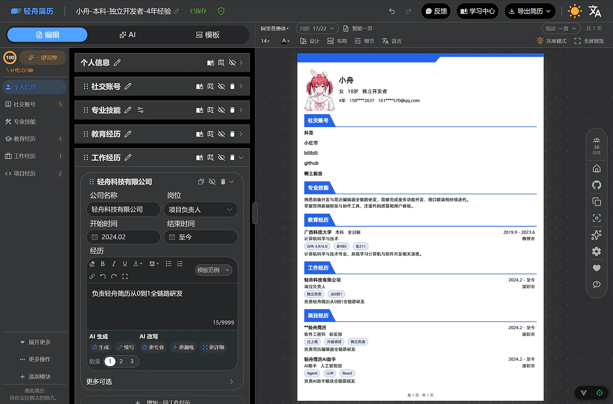
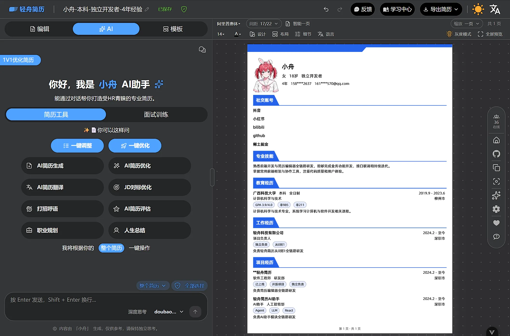

# Skiff Resume

A free, open-source resume builder: from template to application, all in one place.

Skiff Resume is a complete online resume workspace where writing, layout, export, AI refinement, and interview preparation all happen on one page. No sign-up is required, data stays local by default, and the whole project is open source and self-hostable.

[简体中文](README.md) | [English](README.en.md)

[](LICENSE)    

[Use online](https://qzcv.net) · [Frontend docs](apps/web/README.md) · [Backend docs](apps/server/README.md)

## Product Preview

<p align="center">
  
</p>

<p align="center">Resume editor: fill in the form on the left while the A4 paginated preview updates on the right, so the export matches what you see</p>

<p align="center">
  
</p>

<p align="center">Xiaozhou AI assistant: generate, refine, translate, and tailor resume content through conversation</p>

## Version History

| Version | Theme | Highlights |
| --- | --- | --- |
| Beta 0.1 | Getting the editor running | Completed the core flow from resume building to live preview, along with the [first technical article](https://juejin.cn/post/7349433271493034034) |
| Beta 1.0 | Bringing content to life on paper | Dynamic forms, live preview and a layout engine landed |
| V1.0 | One-stop resume building | Templates, online editing, layout polish, one-click export, usage statistics |
| V2.0 | AI job-search assistant | Resume generation, content refinement, job tailoring, interview practice |
| V3.0 | Beyond devices and languages | Desktop and mobile support, cross-device transfer, multilingual switching |

## Features

| Area | Description |
| --- | --- |
| Resume editor | Form-based editing with live paginated previews, section management, drag-and-drop ordering, theme switching, and layout adjustments |
| Themes and examples | Layout themes and role-based content examples you can apply and keep editing |
| Import and management | Import existing resumes, manage multiple versions with tags, and save or back up data locally |
| AI resume assistant | Generate, rewrite, score, optimize, and translate content, including through a conversational assistant |
| Job matching | Compare resume evidence against job requirements, preview tailored drafts, and save them as separate versions |
| Interview practice | Mock interviews based on your resume and target role, topic-specific preparation, reviews, and training records |
| Job-search tools | Track applications, interviews, and offers, with guides, resignation decision scoring, offer comparison, and a real hourly wage calculator |
| Export and backup | PDF (generated locally or in the cloud), images, Markdown, and complete JSON backups |

## Architecture

| Layer | Stack |
| --- | --- |
| Web app | Vue 3, TypeScript, Vite, Tailwind CSS |
| Backend | NestJS and TypeORM for cloud PDF rendering, usage statistics, and AI endpoints |
| Agents | Resume generation and optimization, interview practice, and related capabilities in dedicated shared packages |
| Tooling | pnpm workspace and Turbo for unified builds across apps and shared packages |

## Project Structure

| Directory | Responsibility |
| --- | --- |
| `apps/web` | Web application with the editor, templates, workspace, and job-search tools |
| `apps/server` | Backend for PDF export, usage statistics, AI endpoints, and repository star counts |
| `packages/resume-core` | Shared resume fields, formats, media, redaction, and snapshot handling |
| `packages/resume-agent` | Resume generation, import, optimization, scoring, translation, and editing tools |
| `packages/interview-agent` | Interview preparation, simulation, evaluation, and review |
| `packages/agent` | Shared agent assembly and runtime capabilities |
| `packages/ai` | Model requests, streaming response parsing, and provider adapters |
| `deploy` | Deployment configuration |
| `knowledges` | Development conventions and technical notes |

## Local Development

### Requirements

- Node.js: `^20.19.0` or `>=22.12.0`.
- pnpm: Use version `10.34.5`, as declared by the project.

### Installation and Configuration

```shell
pnpm install

# Create local development configuration files
cp apps/web/.env.example apps/web/.env.development
cp apps/server/.env.example apps/server/.env.development
```

Follow the comments in the templates to configure the site URL, service endpoints, resume database, and models. Store actual values in the corresponding environment files and keep them out of version control.

The backend dependency installation also installs the browser engine required for PDF export. If the resume database is unavailable, the backend skips the statistics module and starts the remaining services.

### Start Development Services

```shell
# Start the frontend and backend together
pnpm dev

# Start only the frontend
pnpm dev:web

# Start only the backend
pnpm dev:server
```

The web root redirects to `/resume`. AI providers and models can be configured in the application's AI settings.

### Build

```shell
# Build the workspace
pnpm build

# Build only the frontend
pnpm build:web

# Build only the backend
pnpm build:server
```

The frontend build prerenders public pages and requires the corresponding browser engine in the build environment. See the [frontend documentation](apps/web/README.md), [backend documentation](apps/server/README.md), and [public page documentation](apps/web/src/views/resume/seo/README.md) for configuration and deployment details.

## License

This project is released under the [MIT License](LICENSE) and may be freely used, modified, and distributed.
