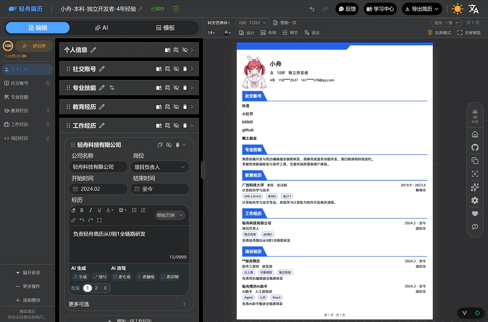
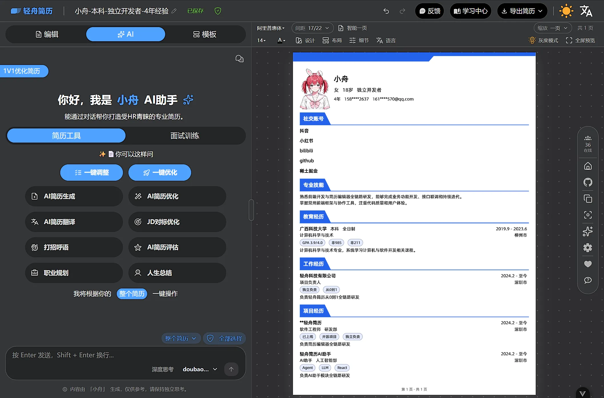

# 轻舟简历

免费、开源的在线简历工具：从范本到投递，一处完成。

轻舟简历是一套完整的在线简历工作台，写作、排版、导出以及 AI 润色、面试准备都在同一个页面里完成。无需注册即可开始，数据默认保存在本地，项目完整开源，也可以自行部署。

[简体中文](README.md) | [English](README.en.md)

[](LICENSE)    

[在线使用](https://qzcv.net) · [网页端说明](apps/web/README.md) · [服务端说明](apps/server/README.md)

## 产品预览

<p align="center">
  
</p>

<p align="center">简历编辑器：左侧表单填写，右侧 A4 分页实时预览，导出结果与所见一致</p>

<p align="center">
  
</p>

<p align="center">小舟 AI 助手：对话式完成简历生成、内容优化、翻译与岗位适配</p>

## 版本历程

| 版本 | 主题 | 主要能力 |
| --- | --- | --- |
| Beta0.1 | 从 0 到 1 跑通编辑器 | 打通从简历制作到实时预览的核心链路，并发布[第一篇技术文章](https://juejin.cn/post/7349433271493034034) |
| Beta1.0 | 让内容跃然纸上 | 动态表单、实时预览与排版引擎三大核心功能落地 |
| V1.0 | 打造一站式制作体验 | 模板套用、在线编辑、排版美化、一键导出、数据统计 |
| V2.0 | 接入 AI 求职助手 | 简历生成、内容优化、岗位适配、面试训练 |
| V3.0 | 打破设备与语言限制 | 手机电脑适配、跨设备互传、多语言切换 |

## 主要功能

| 模块 | 说明 |
| --- | --- |
| 简历编辑 | 表单填写与实时分页预览，支持模块管理、拖拽排序、主题切换与排版调整 |
| 模板与范本 | 多种排版主题与岗位内容范本，可直接套用后继续编辑 |
| 导入与管理 | 导入已有简历，管理多份简历与分类标签，支持本地保存与备份 |
| AI 简历助手 | 简历生成、内容改写、评分、优化与翻译，可通过对话处理简历内容 |
| 岗位适配 | 对照岗位要求分析简历证据，预览并另存定制版本 |
| 面试训练 | 基于简历与目标岗位的模拟面试、专项准备、复盘及训练记录 |
| 求职辅助 | 记录投递、面试与录用进度，提供求职指南、离职决策评分、录用条件对比和真实时薪计算 |
| 导出与备份 | 支持 PDF（本地与云端两种生成方式）、图片与 Markdown 导出，以及 JSON 完整备份 |

## 技术架构

| 层次 | 技术选型 |
| --- | --- |
| 网页端 | Vue 3、TypeScript、Vite、Tailwind CSS |
| 服务端 | NestJS、TypeORM，负责云端 PDF 渲染、使用统计与 AI 接口 |
| 智能体 | 简历生成与优化、面试训练等能力按职责拆分到独立共享包 |
| 工程 | pnpm 工作区 + Turbo，前后端与共享包统一构建 |

## 项目结构

| 目录 | 职责 |
| --- | --- |
| `apps/web` | 简历网页端，包含编辑器、模板、工作区及求职工具 |
| `apps/server` | 简历服务端，提供 PDF 导出、使用统计、AI 接口与仓库星标查询 |
| `packages/resume-core` | 公共简历字段、格式、媒体、脱敏与快照处理 |
| `packages/resume-agent` | 简历生成、导入、优化、评分、翻译与写入工具 |
| `packages/interview-agent` | 面试准备、模拟、评价与复盘能力 |
| `packages/agent` | 通用智能体组装与运行能力 |
| `packages/ai` | 模型请求、流式响应解析与服务商适配 |
| `deploy` | 部署配置 |
| `knowledges` | 项目开发约定与经验文档 |

## 本地运行

### 环境要求

- Node.js：`^20.19.0` 或 `>=22.12.0`。
- pnpm：使用项目声明的 `10.34.5` 版本。

### 安装与配置

```shell
pnpm install

# 创建本地开发环境配置
cp apps/web/.env.example apps/web/.env.development
cp apps/server/.env.example apps/server/.env.development
```

按模板注释填写站点地址、服务接口、简历数据库和模型等配置。实际配置保存在对应的分环境文件中，不提交到仓库。

服务端安装依赖时会安装 PDF 导出所需的浏览器内核。简历数据库连接失败时，服务端会跳过统计模块，其他服务继续启动。

### 启动开发服务

```shell
# 同时启动网页端与服务端
pnpm dev

# 单独启动网页端
pnpm dev:web

# 单独启动服务端
pnpm dev:server
```

网页根路径统一进入 `/resume`。AI 服务商与模型可在应用内的 AI 设置中配置。

### 构建

```shell
# 构建工作区
pnpm build

# 单独构建网页端
pnpm build:web

# 单独构建服务端
pnpm build:server
```

网页端构建包含公开页面预渲染，构建环境需安装相应浏览器内核。详细配置与部署约定见 [网页端说明](apps/web/README.md)、[服务端说明](apps/server/README.md) 和 [公开页面说明](apps/web/src/views/resume/seo/README.md)。

## 开源协议

本项目基于 [MIT License](LICENSE) 开源，可自由使用、修改与分发。
